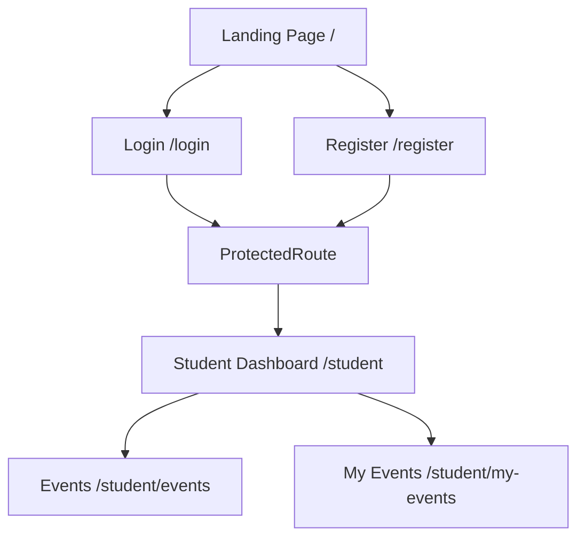

<p align="center">
  
</p>

<h1 align="center">CAMPUSCODE</h1>
<h3 align="center">Dashboard Recreation — Hackathon Round 1</h3>

<p align="center">
  Recreating a polished student platform experience with a faithful front-end build, modern React conversion, and careful design preservation.
</p>

<p align="center">
  
  
  
  
  
  
  
</p>

## About This Project

CampusCode is a dashboard-style student platform concept created as part of a hackathon challenge focused on design recreation. This repository is my Round 1 submission for the Dashboard Recreation challenge, where the goal was to recreate an existing website’s visual identity, structure, and user experience as closely as possible while adapting it into a clean, modern front-end implementation.

The project recreates the major screens and interfaces from the reference site: the landing page, registration flow, login flow, student dashboard, events, and my events views. I began by building the original page layouts using HTML and CSS, then later translated the implementation into React to preserve the look while structuring the experience around reusable components and routes.

---

## Actual Website

[](https://campus-code-ten.vercel.app/)

Visit the live site here: [https://campus-code-ten.vercel.app/](https://campus-code-ten.vercel.app/)

---

## Project Demo Video

<!-- Replace this placeholder with the GitHub demo video link -->


https://github.com/user-attachments/assets/642a3ce7-6435-4aa1-b3ca-1d2fdb93ea58


---

## Hackathon – Round 1 Objective

Round 1 focused on recreating the existing website’s design and experience with the following primary pages:

1. Landing Page
2. Register Page
3. Login Page
4. Student Dashboard

The student dashboard also includes:

- Events Page
- My Events Page

The challenge was not to build a completely new product, but to faithfully recreate the visual structure, interface hierarchy, styling language, and overall flow of the reference website as closely as possible.

---

## Pages Recreated

### Landing Page
The landing page recreates the brand-first experience with a strong hero section, large typography, marketing-focused layout blocks, promotional sections, and a polished digital aesthetic. It includes the main navigation, value propositions, feature storytelling, and CTA-driven sections that define the CampusCode identity.

### Register Page
The registration page mirrors the original auth experience with a dual-panel layout, form field styling, account selection, captcha section, confirmation checkbox, and a consistent dashboard-style design language. The layout is built to match the original reference while remaining structured and easy to navigate in React.

### Login Page
The login UI follows the same design philosophy as the register page, reusing the same shared auth layout and style system. It includes email/password inputs, a captcha challenge, and a security progress interaction that simulates a secure login process.

### Student Dashboard
The student dashboard recreates a compact command-center layout with a left sidebar, topbar, overview metrics, featured event highlights, discovery cards, and dashboard sections that emphasize student activity and engagement. The structure reflects the original site while keeping a clear componentized React setup.

### Events Page
The events page presents a list of event cards with category filtering, status badges, registration actions, and a layout matching the original dashboard recreation. It is designed to feel like a student discovery area for hackathons and quizzes.

### My Events Page
The my events view collects joined or registered activity in a dedicated space, keeping the same visual language as the main events page while presenting each event with registration information and a journey-style action block.

---

## Development Journey

### Phase 1 – Individual HTML and CSS Development
I first built the original page layouts individually using HTML and CSS. The pages were developed separately, including the landing page, register page, login page, and student dashboard. Each page retained its original visual style and layout before being assembled into a broader project structure.

### Phase 2 – Git Branching and Merging
The work was organized across separate Git branches so each page could be developed independently. Once individual implementations were completed, they were merged into the main branch. The original HTML and CSS files were then grouped under the `Desgins` folder to preserve the first implementation separately from the React version.

This structure keeps the original design work accessible and makes it easier to compare the original static implementation with the later React conversion.

### Phase 3 – HTML/CSS to React Conversion
After the original static implementation was complete, the design was converted into React. This involved splitting the interface into reusable components, mapping pages to routes, and reusing styling where possible so the original visual identity stayed intact during the migration to a component-based app.

### Phase 4 – Animations and Finishing Touches
Once the pages were functional in React, attention moved to subtle motion and interaction improvements. This included hover motion, cursor glow effects, page transitions, floating decorative dots, and subtle interaction states that elevate the interface without changing the core original design.

---

## Animations and Interactions

The project includes a small set of carefully implemented motion effects that enhance the original layout without altering its design integrity:

- Cursor-following purple glow: added to the global interface to create a soft ambient motion effect as the pointer moves.
- Floating background dots: used on auth pages to give the background a subtle layered motion effect.
- Hover lift effects: applied to buttons, nav items, and call-to-action elements to create a premium interface response.
- Page fade transitions: used during route changes to create smooth screen-to-screen transitions.
- Login security progress animation: the login screen includes a movement animation and bus-style progress behavior before redirecting to the dashboard.

These effects are implemented in the global motion layer and page-specific styling, especially through `src/styles/animations.css` and the React route transition setup in `src/App.jsx`.

---

## How the Project Works

The application is a route-based React project that recreates the original multi-page website while keeping everything in a single front-end app. Each page retains its original CSS logic by loading its stylesheet only while that page is mounted.



This structure reflects the actual routing in the project, where the landing page, auth pages, and student dashboard are defined as separate routes, with the student area protected behind the route guard.

---

## Technologies Used

| Technology | Purpose |
| --- | --- |
| HTML5 | Original page structure and markup from the static design implementation |
| CSS3 | Page styling, layout design, colors, spacing, and interactive states |
| JavaScript | UI logic, form validation, route behavior, and interactive components |
| React | Component-based front-end rebuild of the original design |
| Vite | Project tooling, local development, and production build |
| React Router | Route-based navigation for landing, auth, and student dashboard pages |
| Framer Motion | Transition and motion effects used across the app |
| Git | Version control for managing page branches and merges |
| GitHub | Repository hosting and project version tracking |

---

## Project Structure

```text
CampusCode-Recreation/
├── Desgins/
│   ├── Dashboard/
│   │   ├── index.html
│   │   └── style.css
│   ├── Login/
│   │   ├── index.html
│   │   └── style.css
│   ├── Register/
│   │   ├── index.html
│   │   └── style.css
│   ├── Student-Dashboard/
│   │   ├── index.html
│   │   ├── Events.html
│   │   ├── My-Events.html
│   │   └── style.css
│   └── assets/
│       └── CampusCode_Showcase.mp4
├── src/
│   ├── App.jsx
│   ├── main.jsx
│   ├── assets/
│   │   └── CampusCode_Showcase.mp4
│   ├── components/
│   │   ├── auth/
│   │   ├── common/
│   │   ├── events/
│   │   ├── landing/
│   │   ├── motion/
│   │   └── student/
│   ├── data/
│   │   └── eventsData.js
│   ├── hooks/
│   │   ├── useDocumentTitle.js
│   │   └── usePageStyles.js
│   ├── pages/
│   │   ├── Dashboard/
│   │   ├── Events/
│   │   ├── Login/
│   │   ├── MyEvents/
│   │   ├── Register/
│   │   └── StudentDashboard/
│   ├── styles/
│   │   ├── animations.css
│   │   ├── pages/
│   │   └── shared/
│   └── utils/
│       └── auth.js
├── index.html
├── package.json
├── package-lock.json
├── vite.config.js
├── .gitignore
├── .oxlintrc.json
├── README.md
└── node_modules/
```

| Path | Purpose |
| --- | --- |
| `Desgins/` | Original static HTML/CSS page files kept separate from the React rebuild |
| `src/pages/` | Main routed pages for the landing experience and student dashboard flow |
| `src/components/` | Reusable UI elements such as navbars, forms, sidebar, cards, and motion components |
| `src/styles/` | Page-specific and shared CSS files, including animation and responsive styling |
| `src/hooks/` | Custom helpers for CSS injection and document titles |
| `src/utils/auth.js` | Demo authentication logic using browser localStorage |
| `src/data/eventsData.js` | Event data used on the Events and My Events screens |
| `src/assets/` | Media assets, including the project showcase video |
| `package.json` | Project dependencies and scripts for running the app |

---

## Round 1 – Development Highlights

- Recreated the core pages of the reference website with close visual fidelity.
- Built the initial implementation in separate HTML and CSS files.
- Managed independent page work using git branches before merging into the main branch.
- Preserved the original static work inside the `Desgins` folder.
- Converted the design into React with reusable, route-based components.
- Added animation and interaction polish to create a more refined front-end experience.
- Completed the Round 1 dashboard recreation challenge.

---

## Round 2 – Future Scope

These are planned improvements for the next phase and are not part of the current completed work:

### Student Dashboard Redesign
The student dashboard is planned for a more complete, modern, and professional redesign. The current version serves as a faithful recreation of the reference design and can be improved with a stronger student-focused UX and information hierarchy.

### Landing Page Improvements
The landing page may be refined further with stronger visual emphasis, improved motion design, and more polished presentation details to better match a premium product style.

### Login and Register Pages
Only minimal visual updates are planned for these pages. The current design is already aligned with the original reference, so the goal is to keep the look intact while making small improvements only where necessary.

### CSS-Generated Header Logo
The header logo, which is currently created using CSS, is an area for future refinement. The aim is to make it cleaner, more consistent, and more polished without changing the overall design direction.

---

## Author

**Shambhavi Chaudhary**

[](https://github.com/Shambhavichaudhary)

---

<p align="center">
  Built through iteration, design study, and a hands-on effort to recreate a polished interface with care.
</p>
